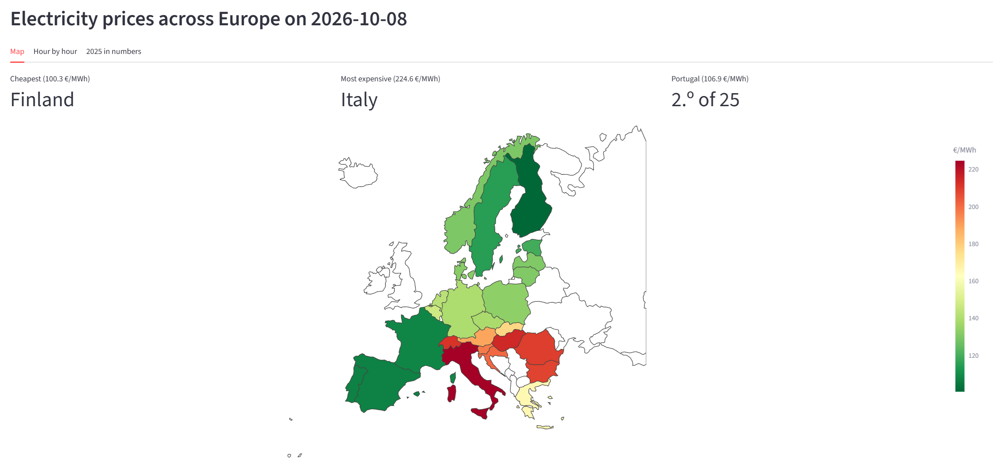
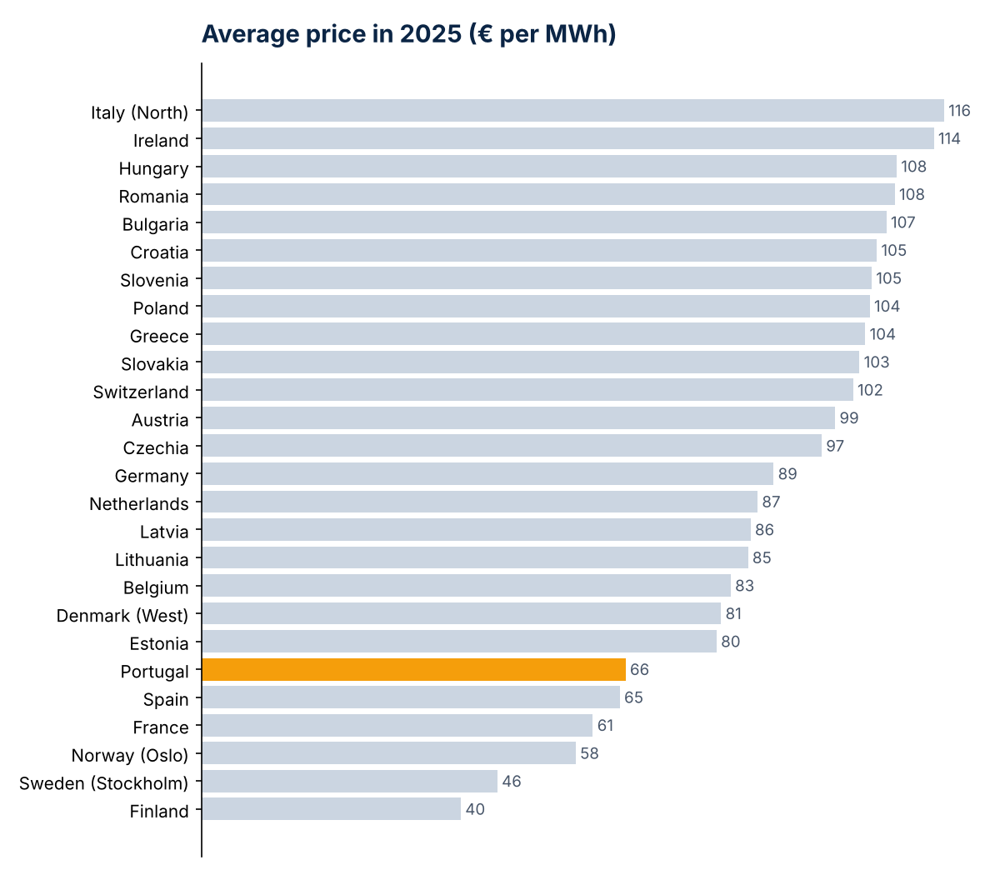
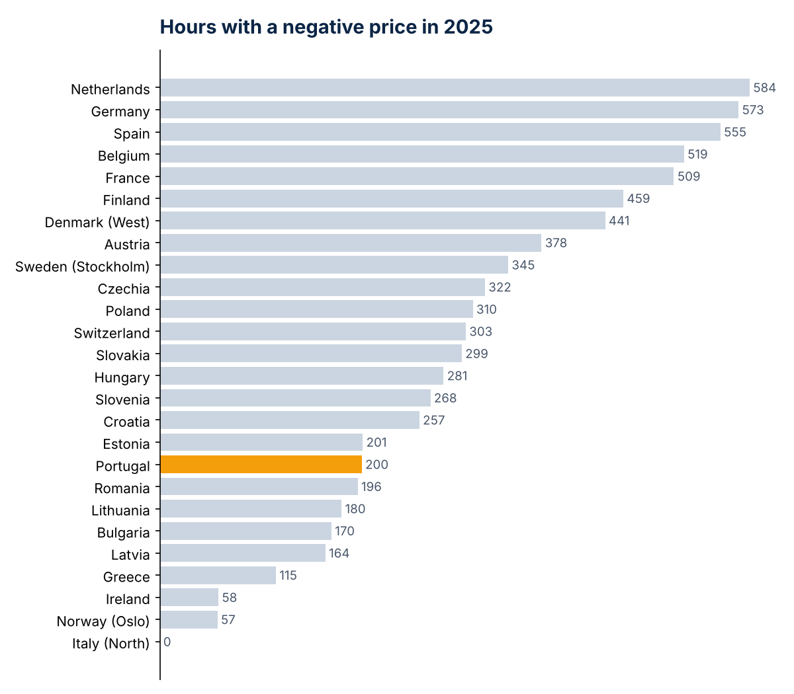
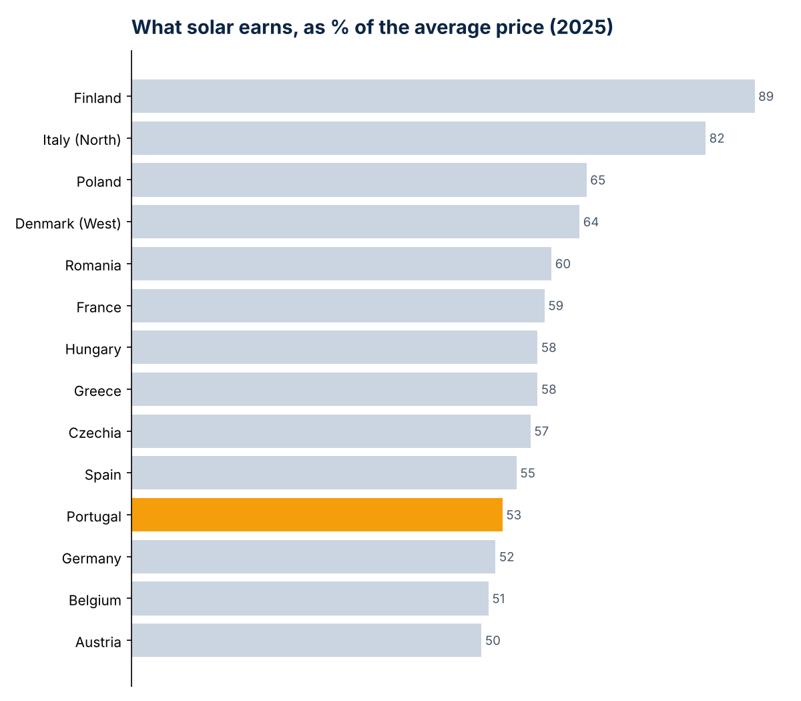
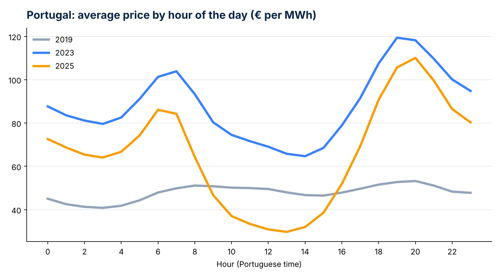
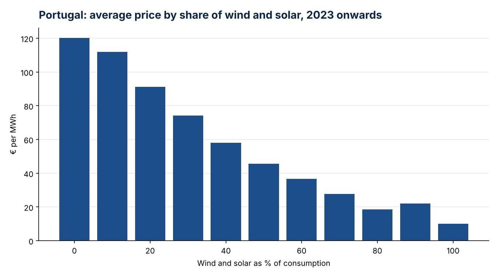
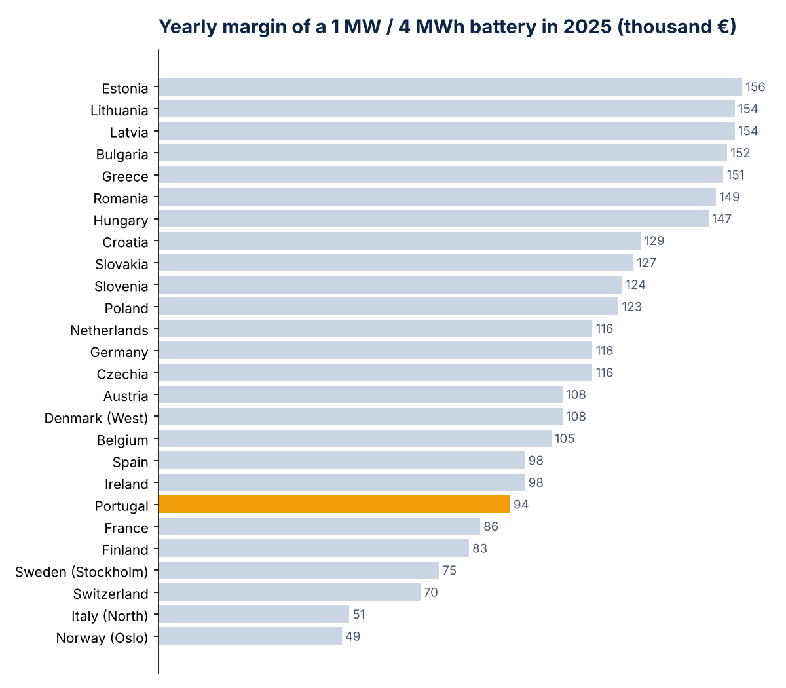

<a href="/#projects">&larr; Back to projects</a>

<h1>Electricity Prices in Europe</h1>

What happens to power prices when a country builds a lot of wind and solar? I track 26 European markets every day to find out.

<a class="et-btn" href="https://european-electricity-tracker.streamlit.app/" target="_blank" rel="noopener"><i class="fa-solid fa-up-right-from-square"></i> Open the live app</a>
<a class="et-btn et-ghost" href="https://github.com/josepaulonunes/european-electricity-tracker" target="_blank" rel="noopener"><i class="fa-brands fa-github"></i> Code and full results</a>

More wind and solar should mean cheaper electricity, and on average it does. But it also means very cheap middays, expensive evenings and more and more hours where producers pay to sell their power. I wanted to know how big these effects really are, so I built a tracker that downloads hourly day-ahead prices for 26 European markets every day, with a closer look at Portugal, where I work on energy regulation.

<b>26</b>markets tracked every day since 2019

<b>7,744</b>hours with a negative price in 2025, up from 829 in 2019

<b>53%</b>of the average price is what solar earned in Portugal in 2025 (102% in 2019)

<b>155k €</b>a year is what a 1 MW battery could make trading in the Baltics in 2025

<h2>Live app</h2>

  
  <button type="button" class="viz-load" id="app-load"><i class="fa-solid fa-hand-pointer"></i> Load the live app</button>

The app runs on Streamlit Community Cloud and updates every afternoon. If nobody has opened it for a while, it can take a minute to wake up. On a phone, it works best <a href="https://european-electricity-tracker.streamlit.app/" target="_blank" rel="noopener">in its own page</a>.

<h2>What I found</h2>

<h3><i class="fa-solid fa-earth-europe"></i> Prices are still very different across Europe</h3>

In 2025 the average price went from 40.5 €/MWh in Finland to 116 €/MWh in Northern Italy. Portugal was the 6th cheapest of 26, at 66 €/MWh.

<h3><i class="fa-solid fa-arrow-trend-down"></i> Negative prices are no longer rare</h3>

Adding up all 26 markets, there were 829 hours with a negative price in 2019 and 7,744 in 2025. The Netherlands, Germany and Spain had the most, with over 550 hours each. Portugal had none until 2024 and more than 500 by October 2026.

<h3><i class="fa-solid fa-sun"></i> Solar is worth about half the average price</h3>

In 2019 solar plants earned roughly the average market price everywhere. In 2025 it was between 50% and 65% in most countries, because all solar panels produce at the same hours and push those prices down together.

<h3><i class="fa-solid fa-clock"></i> In Portugal, middays got cheap and evenings expensive</h3>

In 2019 the price was almost flat during the day. In 2025 it drops at midday, when solar peaks, and jumps in the evening. This shape is called the duck curve.

<h3><i class="fa-solid fa-wind"></i> More wind and solar, lower prices</h3>

Since 2023 the average price in Portugal is about 113 €/MWh when wind and solar cover less than 10% of consumption, and about 15 €/MWh when they cover more than 80%. In a regression, each extra point of wind and solar goes with a price about 0.94 €/MWh lower.

<h3><i class="fa-solid fa-battery-three-quarters"></i> That gap is what pays batteries</h3>

A 1 MW battery with 4 hours of storage, buying in the cheapest hours and selling in the most expensive, would have made about 155 thousand € in the Baltic states in 2025, against about 50 thousand € in Norway and Northern Italy, where prices move much less during the day.

How I did it, and the limits

<ul class="et-list">
<li><strong>Data.</strong> Hourly day-ahead prices for 26 bidding zones since 2019, and solar, wind and consumption for the 15 largest, from the ENTSO-E Transparency Platform API. For Portugal I also use the REN DataHub API (prices until June 2026 and production by source every 15 minutes) and OMIE's daily market files. I checked that the three sources give the same Portuguese prices.</li>
<li><strong>Tools.</strong> The data is cleaned with pandas, stored as CSV files and loaded into SQLite for the analysis with SQL and Python. Every afternoon GitHub Actions runs two Python scripts that add the newest data. The app is built with Streamlit and Plotly.</li>
<li><strong>Solar capture rate.</strong> The average price weighted by solar production, divided by the simple average price.</li>
<li><strong>Regression.</strong> An OLS of the hourly Portuguese price on the share of wind and solar, the share of hydro, demand and year fixed effects, with Newey-West (HAC) standard errors. About 68,000 hours since 2019, R² of 0.49.</li>
<li><strong>Market zones.</strong> Countries with several zones are shown with one of them: Northern Italy, Western Denmark, Stockholm and Oslo.</li>
<li><strong>Limits.</strong> The battery numbers are a rough estimate of the trading margin, not a business case: they ignore the order of the hours, network tariffs, wear and the cost of the battery. Since October 2025 the market uses 15-minute prices, which I average into hours, so the latest negative hour counts are a bit low. The solar capture rate uses market prices only. The regression shows a strong link, not a clean causal effect, since it leaves out the daily gas price.</li>
</ul>

Personal project using public data. Views are my own.

