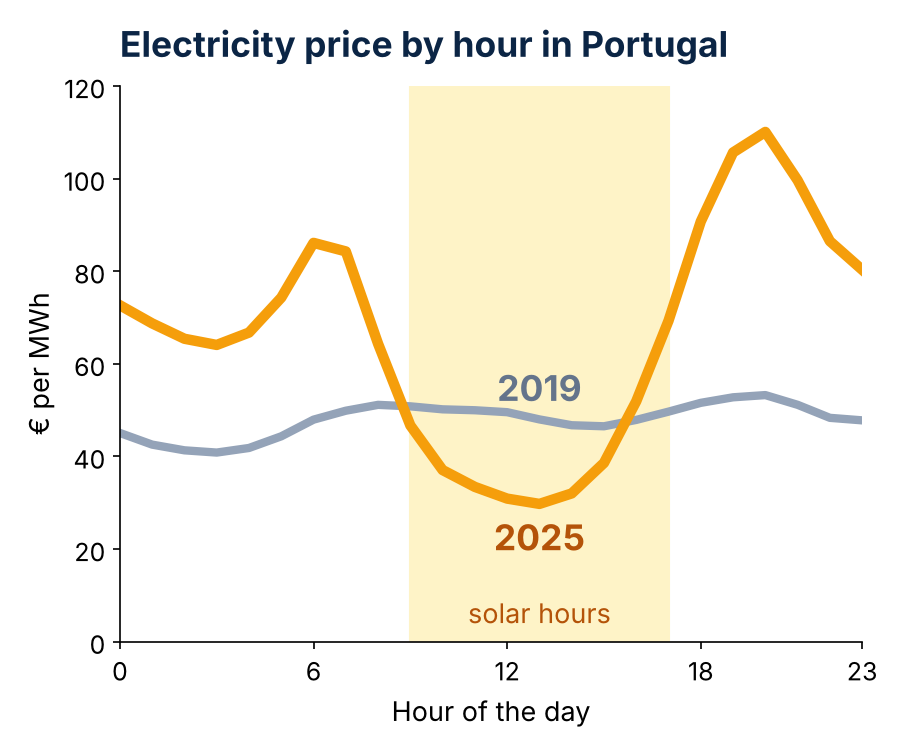
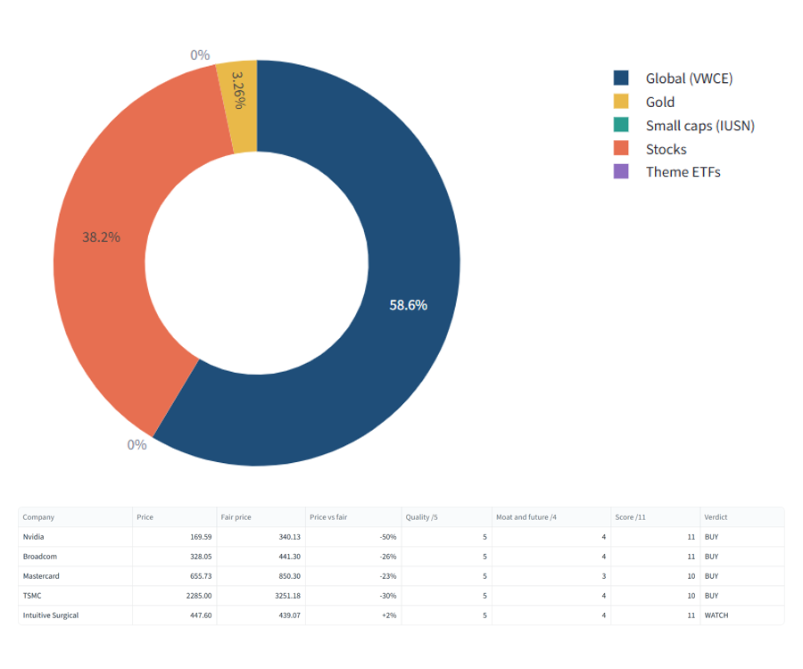
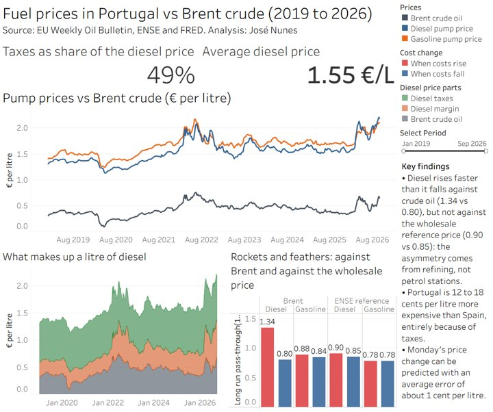

  
  
  

    <h1>José Sá Nunes</h1>

    

      
BSc in Economics, Nova School of Business and Economics

      
Lisbon, Portugal

    

    

      <a href="mailto:jose.sanunes@outlook.com" class="email-link" title="jose.sanunes@outlook.com"><i class="fa-solid fa-envelope"></i>Email</a>
      <a href="https://linkedin.com/in/josepnunes/"><i class="fa-brands fa-linkedin"></i>LinkedIn</a>
      <a href="https://github.com/josepaulonunes"><i class="fa-brands fa-github"></i>GitHub</a>
    

  

I work in energy regulation at ERSE. I'm interested in energy markets, macroeconomics and finance. Here you'll find my data projects and the papers I wrote during my degree.

<h2 id="projects">Projects</h2>

  

    
    

    <h3><a href="/electricity-tracker/">Electricity Prices in Europe</a></h3>
      
Solar is making midday power cheap and evenings expensive. I track day-ahead prices in 26 European markets every day to see how far it goes: hours with a negative price went from 829 in 2019 to 7,744 in 2025, and solar now earns about half the average price in most countries. Comes with a live map of tomorrow's prices.

      
PythonSQLpandasstatsmodelsStreamlitPlotlyGitHub Actions

      

        <a href="/electricity-tracker/"><i class="fa-solid fa-file-lines"></i> Project page</a>
        <a href="https://european-electricity-tracker.streamlit.app/" target="_blank" rel="noopener"><i class="fa-solid fa-chart-line"></i> Live app</a>
        <a href="https://github.com/josepaulonunes/european-electricity-tracker" target="_blank" rel="noopener"><i class="fa-brands fa-github"></i> Code</a>
      

    

  

  

    
    

      <h3><a href="https://investment-lab-josenunes.streamlit.app/">Investment Lab</a></h3>
      
How I invest every month. Each company I follow has its own DCF in Excel, built the way banks do it: a sector beta from similar companies, three scenarios, a reverse DCF and the multiples of its peers. A stock only gets money when its price is close to its fair value. The app shows my real portfolio in percentages, where this month's money goes and how far each stock is from its fair value.

      
ExcelDCFPythonpandasStreamlitPlotly

      

        <a href="https://investment-lab-josenunes.streamlit.app/" target="_blank" rel="noopener"><i class="fa-solid fa-chart-line"></i> Live app</a>
        <a href="https://github.com/josepaulonunes/investment-lab" target="_blank" rel="noopener"><i class="fa-brands fa-github"></i> Code</a>
      

    

  

  

    
    

      <h3><a href="/fuel-prices/">Fuel Prices in Portugal</a></h3>
      
Do pump prices rise faster than they fall? Weekly gasoline and diesel prices in Portugal since 2019, from crude oil to the pump, compared with Spain, plus a forecast for next Monday.

      
PythonpandasstatsmodelsTableau

      

        <a href="/fuel-prices/"><i class="fa-solid fa-file-lines"></i> Project page</a>
        <a href="https://public.tableau.com/app/profile/jos.nunes7914/viz/FuelpricesinPortugalvsBrent/Fuelpricesdashboard" target="_blank" rel="noopener"><i class="fa-solid fa-chart-line"></i> Dashboard</a>
        <a href="https://github.com/josepaulonunes/fuel-prices-portugal" target="_blank" rel="noopener"><i class="fa-brands fa-github"></i> Code</a>
      

    

  

<h2 id="academic">Academic Research</h2>

Written during my bachelor's degree.

<ul class="papers">

<li>
<a href="/PISA_ICT_Math.pdf"><strong>The Impact of ICT Regulations on the Achievement Gap in Mathematics: A Cross-Sectional Analysis</strong></a>
[Summary]

Does stricter school-level regulation of phones and digital devices narrow the maths gap between disadvantaged students and their better-off peers? Using PISA 2022 data on about 82,000 students in ten economies, we estimate weighted least squares models that add socioeconomic, behavioural, school and country fixed-effect controls step by step. Once country fixed effects are included, moving from the least to the most regulated schools is associated with about 25 more points in maths (more than a year of schooling), and about 35 points for disadvantaged students. These are associations from cross-sectional data, not causal effects.

<strong>My contribution:</strong> Wrote the results section and coded all figures and tables. <strong>Grade:</strong> 19/20

</li>

<li>
<a href="/EU_Innovation_Gaps.pdf"><strong>Socioeconomic and Structural Factors in Innovation Gaps: Eastern vs. Western European Union</strong></a>
[Summary]

Why do Eastern EU member states file far fewer patents than Western ones? Using 2017 data for 27 EU countries (patent applications to the European Patent Office, R&amp;D spending, tertiary education, population and unemployment), we estimate OLS models with an East-West indicator and check robustness with HC3 robust standard errors, VIF and RESET tests. Even after these controls, Eastern countries file roughly 45% fewer patents: the factors we measure do not close the gap, which points to institutional differences our data cannot capture.

<strong>My contribution:</strong> Wrote the results section, ran the robustness checks, and coded all figures and tables in R. <strong>Grade:</strong> 18/20

</li>

<li>
<a href="/Tuition_Fee_Reform.pdf"><strong>Tuition Fee Reform: Policy Recommendation</strong></a>
[Summary]

Should university students pay higher tuition fees? Drawing on evidence from Germany's 2007 tuition fee reforms and on public economics tools (externalities, tax incidence, the Ramsey rule and welfare criteria), I argue that raising fees reduces enrolment, falls hardest on low-income students, and is both inefficient and inequitable.

<strong>Grade:</strong> 18/20

</li>

</ul>

